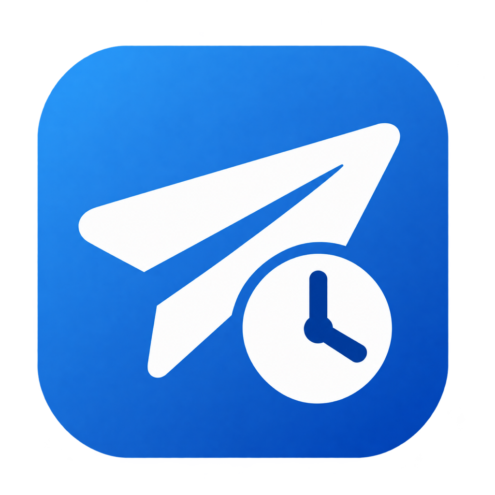

<p align="center">
  
</p>

<h1 align="center">autoSent</h1>

<p align="center">ตั้งเวลาส่งข้อความร่างใน LINE บน Mac ด้วยการกด Enter หนึ่งครั้ง</p>

<p align="center">
  
  
  
</p>

## วิธีใช้

1. เปิดห้องแชต LINE แล้วพิมพ์ข้อความร่าง ตั้งค่า Send key ใน LINE เป็น **Enter**
2. เปิด autoSent เลือกประเภทหน้าต่าง LINE ให้ตรงกับที่ใช้ ตั้งวันและเวลา แล้วกด **Schedule send** ครั้งแรกให้เปิดสิทธิ์ **System Settings → Privacy & Security → Accessibility** สำหรับ autoSent แล้วกดอีกครั้ง
3. กลับไปคลิกช่องพิมพ์ใน LINE ภายใน 5 วินาที เปิดทั้งสองแอปและให้ Mac ตื่นอยู่จนถึงเวลาส่ง ระหว่างรอให้คงห้องแชตและข้อความร่างเดิมไว้

autoSent จะตรวจหน้าต่าง ห้องแชต ช่องพิมพ์ และข้อความร่างก่อนกด Enter หากตรวจสอบไม่ได้หรือเลยช่วงส่งช้าที่ตั้งไว้ (**Maximum lateness** ค่าเริ่มต้น 15 นาที) แอปจะข้ามการกด Enter คุณเลือกได้ว่าจะรับการแจ้งเตือนทั่วไปหรือให้เสียงปลุกดังจนกดรับทราบ

ข้อความร่างอยู่ในหน่วยความจำระหว่างรอส่ง แอปบันทึกผลการกด Enter ล่าสุดไว้บนเครื่อง ส่วนสถานะการส่งถึงผู้รับให้ตรวจใน LINE

## Build จากซอร์ส

ใช้ Mac ที่เป็น Apple silicon และ macOS 13 ขึ้นไป ติดตั้ง Xcode Command Line Tools แล้วรัน

```sh
./scripts/build.sh
open build/autoSent.app
```

หรือเปิด `autoSent.xcodeproj` ใน Xcode แล้ว build ด้วย scheme **autoSent** รันชุดทดสอบได้ด้วย `./scripts/test.sh`
